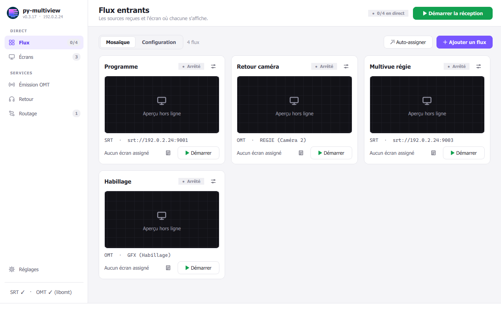

  

  
  
  
  
  

  <a href="#télécharger">Télécharger</a> ·
  <a href="#démarrage-rapide">Démarrage rapide</a> ·
  <a href="docs/guide.md">Guide d'utilisation</a> ·
  <a href="docs/fonctionnement.md">Fonctionnement</a> ·
  <a href="docs/developpement.md">Développement</a>

---

**py-multiview** transforme un PC Windows en mur d'écrans pour la production live. La régie envoie ses flux en **SRT** ou en **OMT**, chaque flux s'affiche en plein écran sur l'écran choisi, et l'application s'occupe du reste : reconnexion quand la source coupe, reprise quand un écran revient, état en direct de chaque sortie. Elle sait aussi publier un écran du poste, avec le son, comme source OMT.

  

## Fonctionnalités

<table>
  <tr>
    <td width="50%" valign="top">
      <h3>📡 Réception SRT et OMT</h3>
      Chaque flux écoute son port SRT (la régie envoie en <i>caller</i>) ou lit une source OMT découverte sur le réseau. L'adresse à saisir dans OBS, vMix ou l'encodeur est affichée et copiable.
    </td>
    <td width="50%" valign="top">
      <h3>🖥️ Un flux par écran</h3>
      Plein écran sur l'écran choisi, en mode adapter, remplir ou étirer, avec rotation. Les écrans gardent leur identité après un redémarrage et s'identifient d'un clic.
    </td>
  </tr>
  <tr>
    <td valign="top">
      <h3>🔁 Toujours à l'antenne</h3>
      Reconnexion automatique quand l'émetteur coupe, reprise quand un écran débranché revient, réglages appliqués à chaud, aucun lecteur orphelin même après un plantage.
    </td>
    <td valign="top">
      <h3>👁️ État et aperçu en direct</h3>
      Chaque carte indique <i>en direct</i>, <i>en attente</i>, <i>reconnexion</i> ou <i>erreur</i> avec la raison, et montre une vignette de ce qu'affiche réellement l'écran.
    </td>
  </tr>
  <tr>
    <td valign="top">
      <h3>🧭 Routage multicast</h3>
      Un flux SRT reçu une seule fois, rediffusé en UDP multicast vers autant d'écrans que nécessaire.
    </td>
    <td valign="top">
      <h3>🎙️ Émission OMT avec le son</h3>
      Publie un écran du poste en OMT, avec le son du PC ou n'importe quelle entrée audio : micro, carte son, câble virtuel, bus vMix.
    </td>
  </tr>
  <tr>
    <td valign="top">
      <h3>🎧 Retour audio du master</h3>
      Écoute le son d'une source OMT sur la sortie du poste, sans image ni fenêtre : le master de la régie reste à l'oreille sans mobiliser un écran.
    </td>
    <td valign="top"></td>
  </tr>
</table>

## Télécharger

| | |
|---|---|
| **[py-multiview-setup.exe](https://github.com/lfpoulain/py-multiview/releases/latest/download/py-multiview-setup.exe)** | Installeur : menu Démarrer, désinstallation, règles de pare-feu en option. |
| **[py-multiview-portable.zip](https://github.com/lfpoulain/py-multiview/releases/latest/download/py-multiview-portable.zip)** | Portable : dézipper puis lancer `py-multiview.exe`. |

Windows 10/11 64 bits, FFmpeg inclus, rien d'autre à installer. Ces liens donnent toujours la dernière version ; l'historique est dans les [releases](https://github.com/lfpoulain/py-multiview/releases). L'exécutable n'est pas signé : si SmartScreen s'affiche, choisir « Informations complémentaires » puis « Exécuter quand même ».

## Démarrage rapide

1. **Ajouter un flux**, ou **Auto-assigner** pour en créer un par écran.
2. Sur la carte, choisir l'**écran** de sortie.
3. **Démarrer la réception**.
4. Dans OBS, vMix ou l'encodeur, envoyer en SRT *caller* vers l'adresse de la carte, par exemple `srt://192.168.1.20:9001`.

Le flux passe *en direct* dès que l'image arrive. Le [guide d'utilisation](docs/guide.md) détaille l'OMT, le routage multicast, l'émission, le retour audio, le réseau et le dépannage.

## Documentation

| Document | Pour qui | Contenu |
|---|---|---|
| [Guide d'utilisation](docs/guide.md) | Opérateurs | Mise en place, réception, routage, émission, préférences, réseau, dépannage |
| [Fonctionnement](docs/fonctionnement.md) | Curieux, développeurs | Les deux FFmpeg, le moteur, la supervision des processus, l'aperçu, l'audio |
| [Développement](docs/developpement.md) | Développeurs | Lancer depuis les sources, tests, build, releases automatiques |

## Licence

py-multiview © 2026 LFPoulain — [CC BY-NC-SA 4.0](LICENSE). Les composants embarqués (FFmpeg, libomt, Qt, PortAudio…) sont listés dans [THIRD_PARTY_NOTICES.md](THIRD_PARTY_NOTICES.md).
