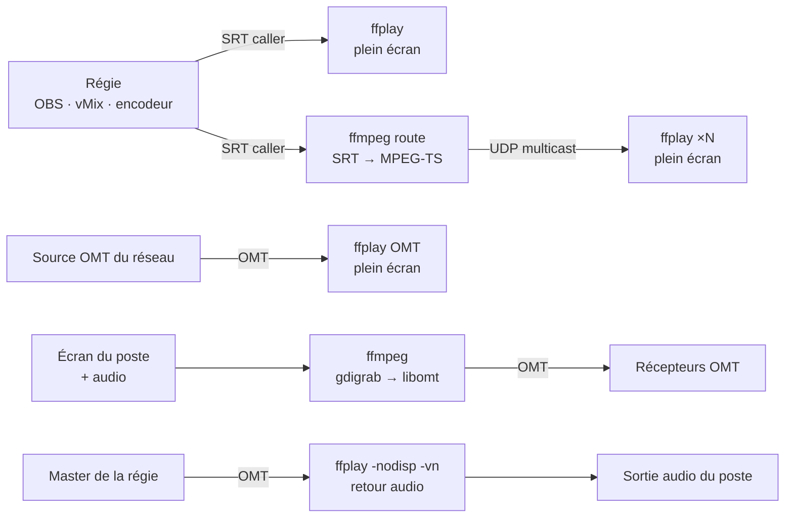

# Fonctionnement

[← Retour au README](../README.md)

py-multiview est une application Qt (PySide6) qui pilote des processus FFmpeg. Elle ne décode ni n'affiche la vidéo elle-même : elle décide quels processus doivent tourner, les lance, les surveille et rend compte de leur état.



## Deux FFmpeg

Aucun build FFmpeg ne sait tout faire, l'application en embarque donc deux :

| Dossier | Build | Sert à |
|---|---|---|
| `bin/omt/` | FFmpeg compilé avec **libomt** (Open Media Transport) | Réception et émission OMT, découverte des sources, entrées audio DirectShow |
| `bin/standard/` | FFmpeg [gyan.dev](https://www.gyan.dev/ffmpeg/builds/) « essentials » avec **libsrt** et les décodeurs GPU | Réception SRT, routes multicast, lecture UDP |

Au démarrage, chaque binaire est interrogé (`-protocols`, `-formats`, `-decoders`) sur ce qu'il sait réellement faire, et chaque tâche reçoit un build capable de l'exécuter. Un FFmpeg du `PATH` sert de dernier recours. Le diagnostic est visible dans **Préférences → Moteur FFmpeg**.

## Le moteur à état désiré

L'interface ne lance jamais un processus. Elle modifie la configuration et exprime une intention : *ce flux doit tourner*, *cette route doit tourner*, *l'émission doit tourner*, *le retour audio doit tourner*. Deux fois par seconde, `Engine.reconcile()` confronte cette intention à la configuration et aux écrans détectés, puis :

- lance ce qui manque ;
- relance ce dont la ligne de commande a changé : c'est ainsi que les réglages s'appliquent à chaud ;
- arrête ce qui n'est plus voulu ;
- explique ce qui ne peut pas tourner : pas d'écran, écran débranché, port SRT déjà pris par un autre flux, build FFmpeg manquant…

Une intention n'est pas oubliée quand elle échoue. Un flux dont l'écran est débranché reste « voulu » et redémarre seul quand l'écran revient. Les écrans sont réénumérés toutes les 3 secondes.

## Supervision des processus

Chaque processus enfant est suivi par le superviseur (`process.py`) :

- **Détection du signal** : ffplay est lancé avec `-stats` et ffmpeg avec `-progress`. Tant que l'horloge de lecture ou le volume de sortie avance, le flux est *en direct* ; sinon il est *en attente*.
- **Relance** : un processus qui s'arrête est relancé, d'abord après 0,5 s puis avec un délai qui double jusqu'à 10 s. Ce délai revient à 0,5 s après une période stable.
- **Réarmement SRT** : ffplay tourne avec `-autoexit`. Quand la régie coupe, il se termine au lieu de rester figé sur la dernière image, et le superviseur relance aussitôt un listener prêt pour la reconnexion.
- **Aucun orphelin** : sous Windows, tous les enfants sont rattachés à un *Job Object* `KILL_ON_JOB_CLOSE`. Ils disparaissent avec l'application, même si elle plante ou est tuée.
- **Journaux** : la sortie de chaque processus est conservée (300 lignes) et consultable en direct depuis l'interface.

## Affichage

- ffplay est placé sur l'écran cible (`-left`, `-top`) puis passé en plein écran sans bordure. SDL travaille en coordonnées physiques (`SDL_WINDOWS_DPI_AWARENESS=permonitorv2`), comme l'énumération Win32 des écrans, et ne se réduit pas quand on clique sur un autre écran.
- **Adapter** ne coûte rien au processeur : la mise à l'échelle est faite par le rendu GPU de ffplay. **Remplir** ajoute seulement un `crop`, **Étirer** un `setdar`, et la rotation un `transpose`.
- Les écrans sont identifiés par un hash de l'identifiant matériel du moniteur et de la carte graphique. Les affectations survivent donc aux redémarrages, aux changements de disposition et aux rebranchements.

## Aperçu

La vignette d'une carte est une capture de l'écran de sortie lui-même, faite par Qt toutes les 2 secondes. Elle montre exactement ce que voit le public (bandes noires, rotation, recadrage) et ne demande pas de décoder le flux une seconde fois. L'aperçu agrandi utilise la même capture, rafraîchie toutes les 500 ms.

## Émission OMT et audio

L'émission capture l'écran avec `gdigrab` à cadence constante et l'envoie au muxer `libomt` sans réencodage (`wrapped_avframe`). Pour l'audio :

- **Entrée DirectShow** : ffmpeg ouvre directement le périphérique (`-f dshow -i audio=…`).
- **Son du PC** : FFmpeg ne sait pas capturer le *loopback* WASAPI. L'application capture donc la sortie audio par défaut avec PyAudioWPatch et l'écrit en PCM brut sur l'entrée standard de ffmpeg. Les échantillons capturés partent dès que WASAPI les livre ; l'horloge murale ne sert qu'à combler de silence les vrais trous, car le loopback ne fournit rien quand le PC est muet.

L'audio est rééchantillonné en 48 kHz stéréo. La compensation de dérive reste douce (`aresample=async=1`, coupe franche seulement au-delà de 100 ms) : une valeur plus agressive réagirait à chaque micro-gigue des horodatages de capture et ferait « chanter » le son. Le muxage n'attend jamais l'image (`-max_interleave_delta 0`), sinon un à-coup de `gdigrab` libérerait l'audio par paquets.

## Retour audio OMT

Le retour du master est un `ffplay -nodisp -vn` sur la source OMT choisie : sans fenêtre et sans flux vidéo mappé, les trames non compressées sont jetées dès le démultiplexage et ne retardent jamais le son. C'est aussi pourquoi la réception *avec* image reçoit `-infbuf` : une trame OMT 1080p pèse ~4 Mo, une 2160p ~16 Mo, alors que ffplay plafonne l'ensemble de ses files de paquets à 15 Mo — sans cela le thread de lecture se met en pause à chaque trame et la file audio se vide.

## Routage multicast

Une route est un `ffmpeg` qui écoute en SRT et recopie le flux en MPEG-TS vers un groupe multicast (`-c copy`, en-têtes réémis pour les lecteurs qui arrivent en cours de route). L'émission et l'abonnement au groupe sont liés à la même interface réseau (`localaddr`), pour éviter que Windows choisisse une carte VPN ou Hyper-V différente de chaque côté.

## Configuration

`config.py` normalise toute configuration lue : types, bornes, identifiants dupliqués, références vers des routes supprimées, anciens champs. Le reste du code n'a ainsi jamais à se méfier des données. L'écriture est atomique (fichier temporaire, `fsync`, `os.replace`), et un fichier illisible est mis de côté plutôt qu'écrasé.

## Organisation du code

```text
py_multiview/
├── app.py          point d'entrée : journaux, instance unique, thème
├── engine.py       moteur à état désiré
├── process.py      superviseur : relance, détection du signal, Job Object
├── ffmpeg.py       détection des builds FFmpeg, construction des commandes
├── audio.py        sources audio de l'émission (loopback, DirectShow)
├── config.py       configuration : valeurs par défaut, normalisation, sauvegarde
├── displays.py     écrans Windows avec identifiants stables
├── omt.py          découverte des sources OMT
├── network.py      adresse IP locale
├── logs.py         journal de l'application
├── paths.py        emplacements (sources ou exécutable)
└── ui/
    ├── main_window.py   fenêtre principale
    ├── stream_card.py   carte d'un flux
    ├── preview.py       aperçu des écrans de sortie
    ├── dialogs.py       journaux, découverte OMT, routes, préférences, identification
    ├── widgets.py       composants réutilisables
    └── theme.py         thème sombre et icônes vectorielles
```
