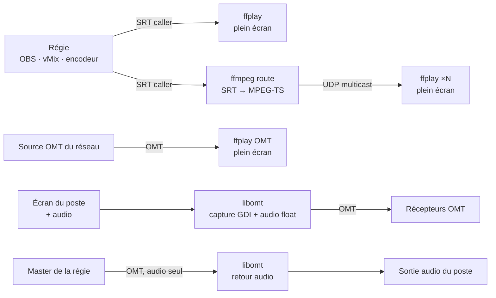

# Fonctionnement

[← Retour au README](../README.md)

py-multiview est une application Qt (PySide6) qui pilote des processus FFmpeg. Elle ne décode ni n'affiche la vidéo elle-même : elle décide quels processus doivent tourner, les lance, les surveille et rend compte de leur état.



## libomt en direct, FFmpeg pour l'image

Les tâches **OMT qui portent du son** — l'émission et le retour audio — parlent directement à `libomt.dll`, la bibliothèque [Open Media Transport](https://github.com/openmediatransport/libomt), via `ctypes`. Elle est déjà livrée dans `bin/omt/` puisque le FFmpeg OMT s'appuie dessus : aucune dépendance supplémentaire.

Ce que cela change par rapport à un passage par FFmpeg :

| | FFmpeg | libomt en direct |
|---|---|---|
| Audio | converti en `pcm_s16le`, recalé par `aresample`, entrelacé avec l'image par le muxer | `FPA1` (float 32 bits planaire), le format natif d'OMT, publié tel quel |
| Retour audio | la vidéo est reçue et décodée puis jetée | le récepteur demande `OMTFrameType_Audio` : la connexion vidéo n'est jamais ouverte |
| Découverte | un processus `ffmpeg -find_sources`, plusieurs secondes | `omt_discovery_getaddresses()`, la liste mDNS déjà en mémoire |
| Émission 1080p30, un récepteur | 43 % d'un cœur (mesuré avec `-benchmark`) | 26 % d'un cœur : pas de conversion `swscale` vers UYVY, pas de pipeline de filtres |

La capture d'écran est un `BitBlt` GDI dans une DIB réutilisée (`capture.py`), ce que fait `gdigrab` ; les octets sont déjà en BGRA, le format que `libomt` encode directement en VMX1. La zone demandée est ramenée dans le bureau virtuel si elle en sort — avec plusieurs écrans à des échelles différentes, la position annoncée peut tomber à côté, et `BitBlt` ne copie alors rien. Comme GDI ne sait pas relire le contenu rendu par le GPU, l'émission vérifie une fois par seconde que l'image n'est pas uniformément noire et l'écrit dans son journal : cela sépare une capture noire d'un problème de transport.

Le repli FFmpeg reste disponible (Préférences → *Émettre en direct par libomt*), ce qui permet de comparer les deux chaînes sur une même machine.

Les deux tâches tournent sur des threads de l'application plutôt que dans des processus enfants (`native.py`), avec la même surface qu'un processus supervisé : état, relance avec temporisation croissante, journal. Si `libomt.dll` ne se charge pas, `omtlib.available()` est faux et tout repasse par les commandes FFmpeg, qui restent testées.

L'**affichage vidéo** reste à ffplay : rendu GPU par SDL, un processus par écran que le superviseur peut relancer, rattaché au Job Object.

## Deux FFmpeg

Aucun build FFmpeg ne sait tout faire, l'application en embarque donc deux :

| Dossier | Build | Sert à |
|---|---|---|
| `bin/omt/` | FFmpeg compilé avec **libomt** (Open Media Transport), et `libomt.dll` elle-même | Affichage des sources OMT, et repli pour l'émission et le retour audio |
| `bin/standard/` | FFmpeg [gyan.dev](https://www.gyan.dev/ffmpeg/builds/) « essentials » avec **libsrt** et les décodeurs GPU | Réception SRT, routes multicast, lecture UDP |

Au démarrage, chaque binaire est interrogé (`-protocols`, `-formats`, `-decoders`) sur ce qu'il sait réellement faire, et chaque tâche reçoit un build capable de l'exécuter. Un FFmpeg du `PATH` sert de dernier recours. Le diagnostic est visible dans **Préférences → Moteur FFmpeg**.

## Le moteur à état désiré

L'interface ne lance jamais un processus. Elle modifie la configuration et exprime une intention : *ce flux doit tourner*, *cette route doit tourner*, *l'émission doit tourner*, *le retour audio doit tourner*. Deux fois par seconde, `Engine.reconcile()` confronte cette intention à la configuration et aux écrans détectés, puis :

- lance ce qui manque ;
- relance ce dont la ligne de commande a changé : c'est ainsi que les réglages s'appliquent à chaud ;
- arrête ce qui n'est plus voulu ;
- explique ce qui ne peut pas tourner : pas d'écran, écran débranché, port SRT déjà pris par un autre flux, build FFmpeg manquant…

Une intention n'est pas oubliée quand elle échoue. Un flux dont l'écran est débranché reste « voulu » et redémarre seul quand l'écran revient. Les écrans sont réénumérés toutes les 3 secondes.

## Supervision des processus

Chaque processus enfant est suivi par le superviseur (`process.py`) :

- **Détection du signal** : ffplay est lancé avec `-stats` et ffmpeg avec `-progress`. Tant que l'horloge de lecture ou le volume de sortie avance, le flux est *en direct* ; sinon il est *en attente*.
- **Relance** : un processus qui s'arrête est relancé, d'abord après 0,5 s puis avec un délai qui double jusqu'à 10 s. Ce délai revient à 0,5 s après une période stable.
- **Réarmement SRT** : ffplay tourne avec `-autoexit`. Quand la régie coupe, il se termine au lieu de rester figé sur la dernière image, et le superviseur relance aussitôt un listener prêt pour la reconnexion.
- **Aucun orphelin** : sous Windows, tous les enfants sont rattachés à un *Job Object* `KILL_ON_JOB_CLOSE`. Ils disparaissent avec l'application, même si elle plante ou est tuée.
- **Journaux** : la sortie de chaque processus est conservée (300 lignes) et consultable en direct depuis l'interface.

## Affichage

- ffplay est placé sur l'écran cible (`-left`, `-top`) puis passé en plein écran sans bordure. SDL travaille en coordonnées physiques (`SDL_WINDOWS_DPI_AWARENESS=permonitorv2`), comme l'énumération Win32 des écrans, et ne se réduit pas quand on clique sur un autre écran.
- **Adapter** ne coûte rien au processeur : la mise à l'échelle est faite par le rendu GPU de ffplay. **Remplir** ajoute seulement un `crop`, **Étirer** un `setdar`, et la rotation un `transpose`.
- Les écrans sont identifiés par un hash de l'identifiant matériel du moniteur et de la carte graphique. Les affectations survivent donc aux redémarrages, aux changements de disposition et aux rebranchements.

## Aperçu

La vignette d'une carte est une capture de l'écran de sortie lui-même, faite par Qt toutes les 2 secondes. Elle montre exactement ce que voit le public (bandes noires, rotation, recadrage) et ne demande pas de décoder le flux une seconde fois. L'aperçu agrandi utilise la même capture, rafraîchie toutes les 500 ms.

## Émission OMT et audio

L'image part à cadence constante depuis une origine fixe : une capture lente ne décale pas toutes les suivantes. Les trames BGRA sont remises à `omt_send`, qui les encode en VMX1.

L'audio est publié par un thread séparé, sur sa propre horloge :

- **Son du PC** : *loopback* WASAPI de la sortie par défaut, via PyAudioWPatch, directement en float 32 bits.
- **Entrée** : n'importe quel point de capture WASAPI — micro, carte son, câble virtuel, bus vMix. Les configurations écrites par les versions précédentes nomment ces entrées `dshow:…` ; elles désignent le même matériel et sont retrouvées par leur nom.

**Les horodatages audio viennent du nombre d'échantillons déjà publiés**, pas de l'horloge murale : c'est ce qui garantit un flux continu pour le récepteur, même si la capture gigue. Un *loopback* ne livre rien quand le PC est muet ; le silence n'est fabriqué que lorsque le périphérique se tait vraiment, et un coussin de 60 ms évite que ce silence repousse les échantillons qui reprennent juste après.

Quand `libomt` n'est pas chargeable, l'émission repasse par `ffmpeg gdigrab → libomt`. Le son y est converti en `pcm_s16le` et sa dérive compensée en douceur (`aresample=async=1`, coupe franche seulement au-delà de 100 ms) : une valeur plus agressive réagirait à chaque micro-gigue des horodatages de capture et ferait « chanter » le son. Le muxage n'attend jamais l'image (`-max_interleave_delta 0`), sinon un à-coup de `gdigrab` libérerait l'audio par paquets.

## Retour audio OMT

La **fenêtre flottante** est un `ffplay -alwaysontop` dimensionné, volume propre, sur la source choisie — le seul lecteur de l'application qui ne prenne pas un écran entier.

Le récepteur audio ne demande que `OMTFrameType_Audio`, donc la connexion vidéo n'est jamais ouverte : aucune trame d'image ne traverse le réseau ni le décodeur. Les échantillons arrivent en float planaire, sont entrelacés et joués par PortAudio, dont l'écriture bloquante cadence la lecture. Le volume est un simple gain appliqué à la volée, sans redémarrer le récepteur.

Le repli FFmpeg est un `ffplay -nodisp -vn`, qui jette les trames vidéo dès le démultiplexage. C'est aussi pourquoi la réception *avec* image reçoit `-infbuf` : OMT transporte la vidéo compressée en VMX1, mais ffplay met en file les trames **décodées**, soit ~4 Mo en 1080p et ~16 Mo en 2160p, alors qu'il plafonne l'ensemble de ses files de paquets à 15 Mo. Sans cela le thread de lecture se met en pause à chaque trame et la file audio se vide.

## API de pilotage

L'API (`api.py`) est un `ThreadingHTTPServer` de la bibliothèque standard : aucune dépendance ajoutée. Son routage est une fonction pure, donc testable sans ouvrir de socket, et les commandes (`control.py`) **ne s'exécutent jamais sur le fil HTTP** : chaque requête est postée à l'interface par un signal Qt en connexion différée, qui possède le moteur, puis attend le résultat. Le moteur n'est ainsi jamais manipulé par deux fils à la fois.

Le contrat suit celui des services que py-livedeck pilote déjà — `GET /status` renvoyant tout l'état avec une clé `connected`, commandes `POST /<objet>/<id>/<verbe>` à corps vide, réponse qui réémet l'état. Les détails sont dans [l'API de pilotage local](api.md).

## Routage multicast

Une route est un `ffmpeg` qui écoute en SRT et recopie le flux en MPEG-TS vers un groupe multicast (`-c copy`, en-têtes réémis pour les lecteurs qui arrivent en cours de route). L'émission et l'abonnement au groupe sont liés à la même interface réseau (`localaddr`), pour éviter que Windows choisisse une carte VPN ou Hyper-V différente de chaque côté.

## Configuration

`config.py` normalise toute configuration lue : types, bornes, identifiants dupliqués, références vers des routes supprimées, anciens champs. Le reste du code n'a ainsi jamais à se méfier des données. L'écriture est atomique (fichier temporaire, `fsync`, `os.replace`), et un fichier illisible est mis de côté plutôt qu'écrasé.

## Organisation du code

```text
py_multiview/
├── app.py          point d'entrée : journaux, instance unique, thème
├── engine.py       moteur à état désiré
├── process.py      superviseur : relance, détection du signal, Job Object
├── ffmpeg.py       détection des builds FFmpeg, construction des commandes
├── api.py          routage HTTP de l'API de pilotage local
├── control.py      actions exposées par l'API, exécutées sur le fil de l'interface
├── omtlib.py       liaison ctypes vers libomt (découverte, réception, émission)
├── native.py       émission et retour audio en direct sur libomt
├── capture.py      capture d'écran GDI en BGRA
├── audio.py        points de capture audio (loopback WASAPI, entrées)
├── config.py       configuration : valeurs par défaut, normalisation, sauvegarde
├── displays.py     écrans Windows avec identifiants stables
├── omt.py          découverte des sources OMT
├── network.py      adresse IP locale
├── logs.py         journal de l'application
├── paths.py        emplacements (sources ou exécutable)
└── ui/
    ├── main_window.py   fenêtre principale
    ├── stream_card.py   carte d'un flux
    ├── preview.py       aperçu des écrans de sortie
    ├── dialogs.py       journaux, découverte OMT, routes, préférences, identification
    ├── widgets.py       composants réutilisables
    └── theme.py         thème sombre et icônes vectorielles
```
